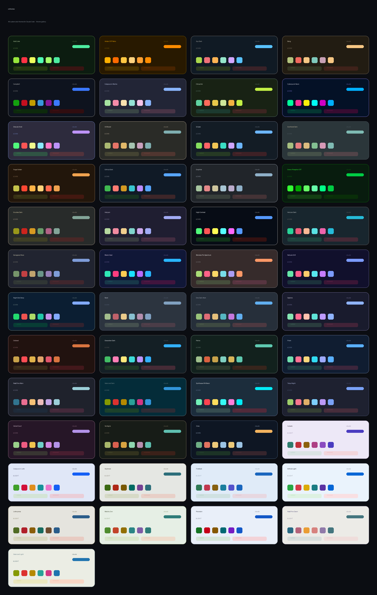

# ccthemes

A curated gallery of **custom color themes for [Claude Code](https://claude.com/claude-code)**. Dozens of hand-tuned dark and light themes that drop straight into your `/theme` picker, plus a builder for your own and a one-command way to contribute it back.

```
/plugin marketplace add livlign/ccthemes
/plugin install theme-gallery@ccthemes
```

Then open `/theme` and pick one. It recolors Claude Code's accent, diffs, status, and borders, and hot-reloads live.

> Requires Claude Code **v2.1.118+** (custom theme support).

## The gallery



## What you get

| | |
|---|---|
| **A full picker of themes** | Dracula, Nord, Gruvbox, Tokyo Night, Everforest, Catppuccin, Solarized, Synthwave, Amber CRT, Porcelain, and more, in both dark and light. Shipped by the plugin, so they appear in `/theme` alongside the built-ins. |
| **`/theme-gallery:theme-custom`** | Build your own: pick a base and accent, and it writes and activates a valid theme file for you. |
| **`/theme-gallery:theme-contribute`** | Validate one of your themes and open a PR to add it to this gallery. |

Every theme sets the tokens that actually change how Claude Code looks: the `claude`
accent (spinner, assistant label), `diffAdded` and `diffRemoved` line backgrounds tuned
to each theme's own hue, `success`, `error`, `warning`, and the mode and prompt borders.

## Themes as files

Each theme is a small JSON file in [`plugins/theme-gallery/themes/`](plugins/theme-gallery/themes/),
in the shape `{ "name", "base", "overrides" }`, exactly the format Claude Code reads from
`~/.claude/themes/`. Shipped themes appear as `custom:theme-gallery:<slug>` and are
read-only; press `Ctrl+E` on one in `/theme` to fork it into your own editable copy.

## Where the palettes come from

The color systems are derived from [**PoshPalette**](https://github.com/livlign/posh-palette),
a terminal theming tool with a matching set of hand-built palettes, so a theme here lines up
with its PoshPalette namesake and your terminal and your Claude Code session can share one look.

## Known limitation: background and main text

A Claude Code theme colors the **semantic UI**: the accent, diffs, status, borders, and
mode indicators. It does **not** control two of the largest surfaces:

- **The background.** That is your terminal emulator's background, not Claude Code's.
- **The main prose** of Claude's responses and your prompt input, currently rendered in
  your terminal's foreground (or a hardcoded color), with no theme token for it.

So a theme lands best when your **terminal** already matches it: set your terminal to the
[PoshPalette](https://github.com/livlign/posh-palette) namesake (which owns background and
foreground) and the matching theme here harmonizes Claude Code's accents on top. That
pairing is the intended, coherent look. A *light* theme on a *dark* terminal (or vice
versa) will look off because the two halves disagree on the canvas.

This split is not unique to Claude Code; terminal apps generally leave the canvas to the
terminal. Full control over conversation text and background is an [open feature request](https://github.com/anthropics/claude-code/issues/63302)
upstream. We are tracking it and will expand these themes if and when Claude Code exposes
those tokens.

## Contributing

New themes are welcome, and a contribution is a single JSON file. See
[CONTRIBUTING.md](CONTRIBUTING.md), or just run the `theme-contribute` skill and let
it open the PR for you.

## License

MIT, see [LICENSE](LICENSE).
